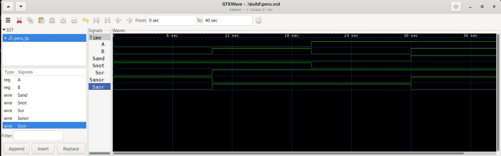

        
# Lab01 - Lógica combinacional

## Integrantes
* [Danna Valentina Jimenez Reyes](https://github.com/dannavajimenezre) 
* [Wilmar Fabian Benavides Rojas](https://github.com/wilmarfabenavidesro) 
# Informe

Indice:

1. [Documentación](#documentación-de-los-circuitos-implementados-implementado)
2. [Simulaciones](#simulaciones)
3. [Evidencias de implementación](#evidencias-de-implementación)
4. [Preguntas](#preguntas)
5. [Conclusiones](#conclusiones)
6. [Referencias](#referencias)

---

## Documentacion del diseño implementado
En esta práctica de laboratorio se trabajó el diseño de circuitos de lógica combinacional utilizando Verilog, partiendo del análisis de las tablas de verdad y de las expresiones booleanas correspondientes.

Inicialmente se implementaron las compuertas lógicas NOT, AND, OR, XOR y XNOR, verificando su comportamiento mediante simulaciones. Posteriormente, se diseñó un circuito combinacional capaz de identificar números primos representados con 3 bits, comprobando todas las combinaciones posibles de entrada.

Finalmente, se implementó un sumador completo de 1 bit, utilizando las entradas (A), (B) y (C_{in}), y obteniendo como salidas la suma (S) y el acarreo (C_{out}). Todos los diseños fueron simulados para comprobar su funcionamiento y posteriormente se llevaron a una implementación en FPGA mediante Quartus, verificando el comportamiento de los circuitos en hardware.

## 1. Compuertas 

### 1.1. Compuerta NOT

La compuerta NOT tiene una entrada y una salida. Su función es invertir el valor lógico de la entrada.

| A | S |
| - | - |
| 0 | 1 |
| 1 | 0 |

Implementación en Verilog:

```verilog
module not_gate(
    input A,
    output S
);

not (S, A);

endmodule
```

### 1.2. Compuerta AND

La compuerta AND produce un `1` únicamente cuando todas sus entradas son `1`.

| A | B | S |
| - | - | - |
| 0 | 0 | 0 |
| 0 | 1 | 0 |
| 1 | 0 | 0 |
| 1 | 1 | 1 |

Implementación en Verilog:

```verilog
module and_gate(
    input A,
    input B,
    output S
);

and (S, A, B);

endmodule
```

### 1.3. Compuerta OR

La compuerta OR produce un `1` cuando al menos una de sus entradas es `1`.

| A | B | S |
| - | - | - |
| 0 | 0 | 0 |
| 0 | 1 | 1 |
| 1 | 0 | 1 |
| 1 | 1 | 1 |

Implementación en Verilog:

```verilog
module or_gate(
    input A,
    input B,
    output S
);

or (S, A, B);

endmodule
```

### 1.4. Compuerta XOR

La compuerta XOR produce un `1` cuando sus entradas son diferentes.

| A | B | S |
| - | - | - |
| 0 | 0 | 0 |
| 0 | 1 | 1 |
| 1 | 0 | 1 |
| 1 | 1 | 0 |

Implementación en Verilog:

```verilog
module xor_gate(
    input A,
    input B,
    output S
);

xor (S, A, B);

endmodule
```

### 1.5. Compuerta XNOR

La compuerta XNOR produce un `1` cuando sus entradas son iguales.

| A | B | S |
| - | - | - |
| 0 | 0 | 1 |
| 0 | 1 | 0 |
| 1 | 0 | 0 |
| 1 | 1 | 1 |

Implementación en Verilog:

```verilog
module xnor_gate(
    input A,
    input B,
    output S
);

xnor (S, A, B);

endmodule
```

### Evidencia de simulación

Las tablas de verdad fueron verificadas mediante simulación de los respectivos módulos desarrollados en Verilog.


---

## 2. Verificador de números primos     

Se diseñó un circuito combinacional capaz de determinar si un número binario de tres bits corresponde a un número primo.

Los números representables con tres bits son:

| A | B | C | Decimal | Primo |
| - | - | - | ------: | ----- |
| 0 | 0 | 0 |       0 | 0     |
| 0 | 0 | 1 |       1 | 0     |
| 0 | 1 | 0 |       2 | 1     |
| 0 | 1 | 1 |       3 | 1     |
| 1 | 0 | 0 |       4 | 0     |
| 1 | 0 | 1 |       5 | 1     |
| 1 | 1 | 0 |       6 | 0     |
| 1 | 1 | 1 |       7 | 1     |

Por lo tanto, la salida debe activarse para los valores 2, 3, 5 y 7.

La función lógica implementada fue:

```text
P = (~A & B) | (~A & C) | (B & C)
```

Implementación en Verilog:

```verilog
module detector_primos(
    input A,
    input B,
    input C,
    output P
);

assign P = (~A & B) | (~A & C) | (B & C);

endmodule
```

### Evidencia de simulación

El funcionamiento del detector de números primos fue comprobado mediante simulación, verificando los ocho posibles valores de entrada.


---

## 3. Sumador de 1 bit

Un sumador completo de un bit posee tres entradas:

* `A`: primer bit de entrada.
* `B`: segundo bit de entrada.
* `Cin`: acarreo de entrada.

Y dos salidas:

* `S`: resultado de la suma.
* `Cout`: acarreo de salida.

### Tabla de verdad

| A | B | Cin | Cout | S |
| - | - | --- | ---- | - |
| 0 | 0 | 0   | 0    | 0 |
| 0 | 0 | 1   | 0    | 1 |
| 0 | 1 | 0   | 0    | 1 |
| 0 | 1 | 1   | 1    | 0 |
| 1 | 0 | 0   | 0    | 1 |
| 1 | 0 | 1   | 1    | 0 |
| 1 | 1 | 0   | 1    | 0 |
| 1 | 1 | 1   | 1    | 1 |

Las expresiones utilizadas fueron:

```text
S = A XOR B XOR Cin

Cout = (A AND B) OR (A AND Cin) OR (B AND Cin)
```

Implementación en Verilog:

```verilog
module sumador_1bit(
    input A,
    input B,
    input Cin,
    output S,
    output Cout
);

assign S = A ^ B ^ Cin;
assign Cout = (A & B) | (A & Cin) | (B & Cin);

endmodule
```

### Evidencia de simulación

El sumador completo fue verificado mediante simulación para las ocho combinaciones posibles de sus entradas.


---

# 4. Implementación en FPGA

Después de verificar los diseños mediante simulación, los circuitos fueron implementados en una tarjeta FPGA utilizando el entorno de desarrollo correspondiente.

La implementación permitió comprobar físicamente el funcionamiento de las compuertas lógicas, el detector de números primos y el sumador de un bit.

### Evidencias de implementación

En esta sección se incorporan las evidencias obtenidas durante la implementación y demostración del funcionamiento de los circuitos en FPGA.

---

# 5. Resultados

A partir de las simulaciones realizadas se comprobó que los circuitos desarrollados presentan el comportamiento esperado de acuerdo con sus respectivas tablas de verdad.

Las compuertas NOT, AND, OR, XOR y XNOR respondieron correctamente ante las combinaciones de entrada establecidas.

El detector de números primos permitió identificar correctamente los valores 2, 3, 5 y 7 dentro del rango de números representables con tres bits.

Finalmente, el sumador completo de un bit presentó correctamente tanto el resultado de la suma como el acarreo de salida para las ocho combinaciones posibles.

La implementación en FPGA permitió comprobar el comportamiento de los diseños más allá de la simulación, relacionando la descripción en HDL con su funcionamiento en hardware.

---

# 6. Conclusiones

* Se reforzaron los conceptos fundamentales de lógica combinacional y funcionamiento de las principales compuertas lógicas.
* Se aprendió a describir circuitos digitales mediante el lenguaje Verilog utilizando primitivas y expresiones estructurales.
* Se comprobó la importancia de las tablas de verdad para verificar el comportamiento esperado de un circuito combinacional.
* Se diseñó e implementó un circuito capaz de identificar números primos representados mediante tres bits.
* Se comprendió el funcionamiento de un sumador completo de un bit y la relación entre el resultado de la suma y el acarreo.
* La implementación en FPGA permitió comprobar experimentalmente los diseños desarrollados y relacionar la simulación con el funcionamiento real del hardware.

---

# 7. Referencias

* Material de clase de la asignatura Técnicas Digitales, Universidad ECCI.
* Documentación y material proporcionado para el Laboratorio 01: Introducción a lógica combinacional.
* IEEE Standard for Verilog Hardware Description Language.

